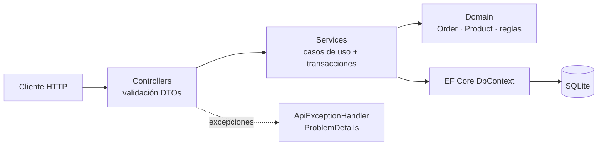

# StockFlow API

[](https://github.com/hectormac35/stockflow-api/actions/workflows/ci.yml)


API REST de **gestión de pedidos e inventario** (un mini-ERP) construida con **ASP.NET Core 8**, **Entity Framework Core** y **SQLite**.

El objetivo del proyecto no es el CRUD, sino modelar **reglas de negocio reales** de forma que no se puedan saltar: el stock solo se descuenta al confirmar un pedido, nunca puede quedar en negativo, una cancelación devuelve las unidades y los precios se congelan en el momento de la venta.

---

## Funcionalidades

- **Productos**: alta, edición, búsqueda por SKU o nombre, entradas de mercancía y aviso de stock bajo.
- **Clientes**: alta con validación de email y NIF/CIF.
- **Pedidos** con ciclo de vida controlado:

  ```
  Draft ──confirm──▶ Confirmed ──ship──▶ Shipped
    │                    │
    └──────cancel────────┴──▶ Cancelled (devuelve stock si estaba confirmado)
  ```

- **Confirmación transaccional**: se comprueban todas las líneas antes de tocar el stock; si falta de algo, el pedido entero se rechaza con un único error que detalla lo que falta.
- **Informes**: productos bajo mínimos y ventas por rango de fechas con top 5 de productos.
- **Errores homogéneos** en formato `ProblemDetails` (RFC 7807): 400 validación, 404 no encontrado, 409 regla de negocio.
- **Swagger / OpenAPI** documentado y endpoint `/health` con comprobación de la base de datos.

## Arquitectura



| Capa | Responsabilidad |
|---|---|
| `Controllers` | HTTP, validación de entrada con DataAnnotations, códigos de respuesta |
| `Services` | Orquestan los casos de uso (crear, confirmar, cancelar…) y gestionan transacciones |
| `Domain` | Entidades con las **reglas de negocio encapsuladas** (`Order.Confirm()`, `Product.RemoveStock()`…) |
| `Data` | `DbContext`, configuración del modelo (índices únicos, precisión decimal, relaciones) y datos de ejemplo |
| `Infrastructure` | Manejo global de excepciones con `IExceptionHandler` |

**Decisiones de diseño**

- Las transiciones de estado del pedido y los movimientos de stock solo se pueden hacer a través de métodos del dominio (`private set`), no asignando propiedades desde fuera.
- El precio de cada línea se copia al crear el pedido: un cambio de precio posterior no altera pedidos existentes.
- DTOs separados de las entidades para no exponer el modelo interno ni provocar ciclos de serialización.
- SQLite para que el proyecto arranque sin instalar nada; cambiar a **SQL Server** solo requiere el proveedor `UseSqlServer` y la cadena de conexión.

## Puesta en marcha

### Con .NET 8

```bash
dotnet run --project src/StockFlow.Api
```

Abre <http://localhost:5080/swagger>. La base de datos se crea sola con productos y clientes de ejemplo.

### Con Docker

```bash
docker compose up --build
```

Abre <http://localhost:8080/swagger>.

### Probar el flujo completo

El fichero [`requests.http`](requests.http) contiene la secuencia lista para ejecutar desde Visual Studio, VS Code o Rider: crear pedido → confirmar → intentar vender más stock del que hay (409) → cancelar → informes.

## Endpoints

| Método | Ruta | Descripción |
|---|---|---|
| GET | `/api/products?search=` | Lista y búsqueda de productos |
| POST | `/api/products` | Alta de producto |
| PUT | `/api/products/{id}` | Edición |
| POST | `/api/products/{id}/stock-in` | Entrada de mercancía |
| GET/POST | `/api/customers` | Clientes |
| GET | `/api/orders?status=&page=&pageSize=` | Pedidos paginados y filtrados |
| POST | `/api/orders` | Crear pedido (borrador) |
| POST | `/api/orders/{id}/confirm` | Confirmar y descontar stock |
| POST | `/api/orders/{id}/ship` | Marcar como enviado |
| POST | `/api/orders/{id}/cancel` | Cancelar (devuelve stock si procede) |
| GET | `/api/reports/low-stock` | Productos bajo mínimos |
| GET | `/api/reports/sales?from=&to=` | Ventas y top productos |
| GET | `/health` | Estado de la API y la base de datos |

## Tests

```bash
dotnet test
```

- **Dominio** (`DomainTests`): reglas de stock, congelación de precios y transiciones de estado.
- **Servicio** (`OrderServiceTests`): contra SQLite en memoria real, incluida la transacción que garantiza que un pedido sin stock suficiente no descuenta nada.
- **Integración** (`ApiIntegrationTests`): levantan la API completa con `WebApplicationFactory` y prueban el flujo HTTP de punta a punta, incluidos los códigos 400, 404 y 409.

El pipeline de **GitHub Actions** compila, ejecuta los tests y construye la imagen Docker en cada push.

## Stack

C# · .NET 8 · ASP.NET Core Web API · Entity Framework Core 8 · SQLite · xUnit · WebApplicationFactory · Swagger/OpenAPI · Docker · GitHub Actions

## Próximos pasos

- Autenticación JWT con roles (comercial / almacén / administrador).
- Proveedor SQL Server y migraciones de EF Core.
- Control de concurrencia optimista sobre el stock (`RowVersion`).
- Despliegue en Azure App Service.

---

Proyecto personal de **Héctor Macarrilla** · [LinkedIn](https://www.linkedin.com/in/hectormacarrilla-maluenda-61ab8289) · [GitHub](https://github.com/hectormac35)
